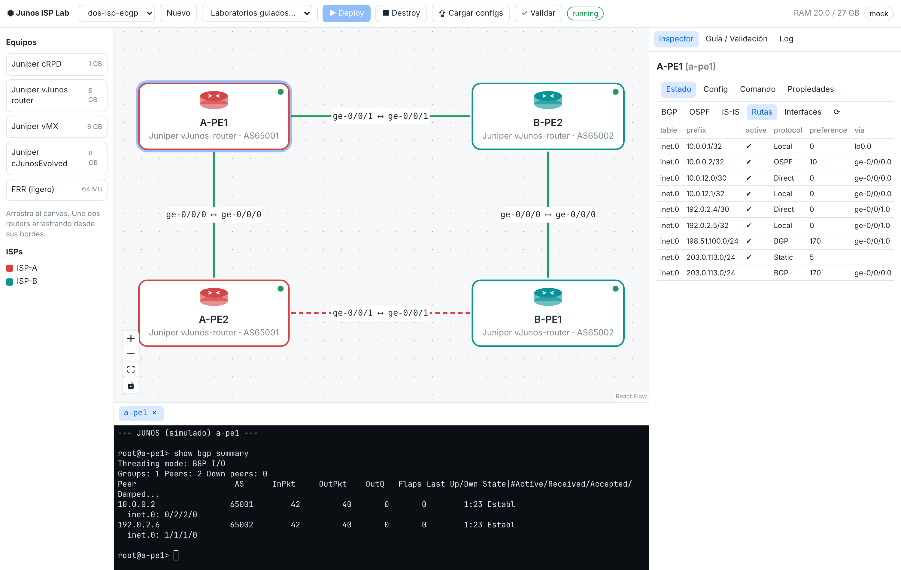

# Junos ISP Lab

Simulador visual open-source tipo *Packet Tracer* para practicar **enrutamiento de proveedores (ISP)** con equipos **Juniper reales**: OSPF/IS-IS, iBGP/eBGP, políticas, communities, Local-Pref, MED, AS-PATH prepend, failover…



- **Canvas** (React Flow): arrastra routers, conéctalos, asigna `ge-0/0/x`, corta enlaces.
- **Consola Junos** en el navegador (xterm.js ⇄ WebSocket ⇄ PTY → `docker exec cli` / `ssh`).
- **Inspector**: tablas BGP/OSPF/IS-IS/rutas/interfaces parseadas de `| display json`.
- **Labs guiados** con validación automática.
- **Motor**: [Containerlab](https://containerlab.dev) (Apache-2.0) + tus imágenes Juniper. Hay también un **driver mock** (CLI simulado) para desarrollar la UI sin imágenes.

## Instalación rápida (recomendada): Cisco IOL + Juniper cRPD

Con IOL y cRPD los routers son **IOS y Junos reales en contenedores**: unos 0.5–1 GB cada uno, arrancan en segundos y **no necesitan virtualización anidada ni ISO**. Con 32 GB de RAM caben 30–50 routers, lo justo para topologías largas con MPLS, BGP y políticas.

En Ubuntu 22.04/24.04 (PC, VM o **WSL2 en Windows**):

```bash
git clone -b claude/practical-mendel-82nfq2 https://github.com/jairojavier56/practicas.git
```

```bash
cd practicas/junos-isp-lab && sudo ./install.sh
```

Después, importa tus imágenes (desde tu PNETLab):

```bash
sudo lab-import-image /ruta/x86_64_crb_linux-adventerprisek9-ms.iol --version 17.12.01
```

```bash
sudo lab-import-image /ruta/junos-routing-crpd-docker-24.2R1.14.tgz
```

Abre `http://localhost:8080` y carga el laboratorio guiado **mpls-l3vpn**: 11 nodos (unos 10 GB) con núcleo y RR Cisco IOL, un PE Juniper vJunos, IS-IS, LDP, route reflector, L3VPN con VRFs solapadas y un tránsito con políticas. Trae 8 pasos de lección con validación automática.

| Imagen | Cómo la importa `lab-import-image` | Notas |
|---|---|---|
| IOL 17.x `x86_64_crb_linux-*.iol` | vrnetlab `cisco/iol` → `cisco_iol-<versión>.bin` | Recomendada. Usa `--version` si el nombre no la trae |
| IOL antiguo `i86bi-linux-l3-*.bin` | igual | 32 bits / 15.x: puede no estar soportado por vrnetlab |
| cRPD `junos-routing-crpd-docker-*.tgz` | `docker load` | MPLS: `install.sh` carga `mpls_router` y `mpls_iptunnel` |
| vJunos (`.qcow2` o `.tgz` de PNETLab) | vrnetlab | Necesita KVM: úsalo para 1–2 routers, no para el lab grande |

Interfaces: IOL usa `Ethernet0/1…0/3, 1/0…` (Ethernet0/0 es la gestión). cRPD y FRR usan `eth1, eth2…`. Las marcas `VERIFICAR` de `config/images.example.yaml` indican qué comprobar la primera vez.

### En Windows (WSL2), con tus ficheros en Descargas

1. **PowerShell como administrador:** `wsl --install -d Ubuntu-24.04` y reinicia.
2. **Recursos de WSL.** Crea `C:\Users\<TU_USUARIO>\.wslconfig` con este contenido y ejecuta `wsl --shutdown`:
   ```ini
   [wsl2]
   memory=14GB
   processors=8
   nestedVirtualization=true
   ```
   El lab `mpls-l3vpn` usa unos 10 GB: 6 Cisco IOL y 1 vJunos. `nestedVirtualization` solo hace falta para vJunos.
3. **En Ubuntu (WSL):**
   ```bash
   git clone -b claude/practical-mendel-82nfq2 https://github.com/jairojavier56/practicas.git && cd practicas/junos-isp-lab && sudo ./install.sh
   ```
4. **Importa tus imágenes.** Windows se ve en `/mnt/c`:
   ```bash
   sudo lab-import-image /mnt/c/Users/<TU_USUARIO>/Downloads/x86_64_crb_linux-adventerprisek9-ms
   ```
   ```bash
   sudo lab-import-image /mnt/c/Users/<TU_USUARIO>/Downloads/vJuniper/vjunosrouter-24.2R1-S2.5.tgz
   ```
   Los `.yml` de PNETLab no hacen falta. Comprueba `ls /dev/kvm` antes de desplegar vJunos.
5. **Abre `http://localhost:8080`** en Windows y elige el laboratorio guiado **mpls-l3vpn**.

---

## 0. Tres formas de usarlo

| Modo | Qué es | Necesitas |
|---|---|---|
| **Lección en el navegador** | `leccion-interactiva.html`: un único fichero, Junos simulado, cero instalación | Solo un navegador |
| **App en modo mock** | Canvas + consola + lecciones con el simulador | Node.js |
| **App con Juniper real** (estilo PNETLab) | La misma app desplegando tus vJunos/cRPD/vMX/vSRX con Containerlab | Linux con KVM, o la **ISO** de abajo |

Las lecciones con `lesson` en `lab.json` (por ejemplo `labs/02-leccion-bgp`) se ven en la pestaña **Lección**. Son los mismos pasos que la versión del navegador, pero sobre routers reales: **▶ Ejecutar** teclea los comandos en la consola del equipo, el backend consulta OSPF/BGP para el **estado en vivo**, y cada paso se marca solo cuando la red real llega al estado esperado.

## Appliance: ISO para instalar en una máquina virtual

`appliance/build-iso.sh` genera una ISO de **Ubuntu Server 24.04 con instalación desatendida**. Arrancas la VM con ella y, sin preguntas, queda instalado Ubuntu + Docker + Containerlab + vrnetlab + la app como servicio en `http://<IP-de-la-VM>:8080`.

**1. Generar la ISO** (en cualquier Linux, o en WSL en Windows):

```bash
sudo apt install -y xorriso curl openssl
```

```bash
git clone -b claude/practical-mendel-82nfq2 https://github.com/jairojavier56/practicas.git
```

```bash
cd practicas/junos-isp-lab && ./appliance/build-iso.sh
```

- Descarga Ubuntu Server (~3 GB), verifica su SHA256 y te pide la contraseña del usuario `lab` (sirve para SSH, la consola y la web).
- Con `--images /carpeta/con/tus/imagenes` mete tus imágenes Juniper en la ISO y se importan solas en el primer arranque. Es solo para uso propio: respeta las licencias de Juniper.
- Opciones: `--iso ubuntu-24.04.x-live-server-amd64.iso` (si ya la tienes), `KEYBOARD=latam` (o `es`, `us`), `TIMEZONE=America/Bogota`.

**2. Crear la VM**

| | Solo cRPD | 4 × vJunos-router (lección incluida) |
|---|---|---|
| vCPU | 4 | 8 |
| RAM | 8 GB | 24–32 GB |
| Disco | 40 GB | 80 GB |

**Virtualización anidada** (obligatoria para vJunos/vMX/vSRX/cJunosEvolved; cRPD no la necesita):
- VMware Workstation/ESXi: *Virtualize Intel VT-x/EPT or AMD-V/RVI*.
- VirtualBox: `VBoxManage modifyvm <vm> --nested-hw-virt on`.
- Proxmox: tipo de CPU `host`.
- Hyper-V: `Set-VMProcessor -VMName <vm> -ExposeVirtualizationExtensions $true`.

Red de la VM: puente (bridge) o NAT con reenvío del puerto 8080.

**3. Arrancar.** La entrada *Instalar Junos ISP Lab* se elige sola. **Borra el disco de la VM.** Reinicia y en el primer arranque instala Docker, Containerlab y la app (10–15 min, necesita internet). La consola de la VM muestra la URL.

**4. Importar tus imágenes Juniper** (si no las metiste en la ISO):

```bash
scp vJunos-router-23.2R1.15.qcow2 lab@IP-DE-LA-VM:
```

```bash
ssh lab@IP-DE-LA-VM sudo lab-import-image vJunos-router-23.2R1.15.qcow2
```

`lab-import-image` detecta el tipo por el nombre (cRPD/cJunosEvolved → `docker load`; vJunos/vMX/vSRX → vrnetlab `make`), registra el tag en `config/images.yaml`, pasa la app a `DRIVER=containerlab` y la reinicia. Si no reconoce el nombre: `--kind crpd|vjunos-router|vmx|vsrx|cjunosevolved`.

Para preparar un Ubuntu 24.04 que **ya tengas instalado** (sin ISO), copia `junos-isp-lab` a `/opt/junos-isp-lab`, crea el usuario `lab` y ejecuta `sudo /opt/junos-isp-lab/appliance/firstboot.sh`.

> La web pide usuario `lab` + tu contraseña (autenticación básica, `WEB_PASSWORD` en `.env`). Úsala en una red de laboratorio, no la expongas a internet.

---

## 1. Arquitectura

```
┌──────────────── Navegador ───────────────┐
│ React + React Flow (canvas)              │
│ xterm.js (consola)   Inspector / Guía    │
└──────┬─────────────────────┬─────────────┘
   REST /api            WebSocket /ws/console (PTY)  ·  /ws/events (estado, logs, enlaces)
┌──────┴─────────────────────┴─────────────┐
│ Backend Node.js (Express + ws + node-pty) │
│  • store: topologías JSON + configs .set  │
│  • NetworkDriver ─┬─ ContainerlabDriver   │  → genera *.clab.yml, deploy/destroy,
│                   │                       │    docker exec / ssh, ip link up/down
│                   └─ MockDriver           │  → simulador OSPF/BGP aproximado
│  • configpush: configure → load set       │
│    terminal → commit (vía consola)        │
│  • validate: checks del lab (JSON Junos)  │
└──────┬────────────────────────────────────┘
       │ containerlab CLI + docker
┌──────┴──────────── Host Linux (KVM) ──────┐
│ cRPD (contenedor) · vJunos/vMX/vSRX (VM   │
│ QEMU dentro de contenedor vrnetlab) ·     │
│ cJunosEvolved · FRR (ligero)              │
│ enlaces = pares veth entre namespaces     │
└───────────────────────────────────────────┘
```

**Decisiones clave**

| Decisión | Por qué |
|---|---|
| Containerlab como orquestador | Ya soporta los kinds de Juniper (cRPD, vJunos, vMX, vSRX, cJunosEvolved), cablea con veth y gestiona la red de gestión. No reinventamos el motor. |
| Catálogo `config/images.yaml` | Imágenes, recursos, mapeo de interfaces y comandos de consola **fuera del código** y fuera de git. |
| Config empujada por consola (`load set terminal`) | Funciona igual en cRPD, vJunos, vMX y en el mock, y no depende del formato de `startup-config` de cada kind. Además es lo que hace un ingeniero de verdad. |
| Inspector vía `\| display json` | Parseo estable (sin *screen scraping*) y validaciones automáticas fiables. |
| Panel "Comando" de solo lectura | Solo `show`/`ping`/`traceroute` con pipes seguros. Para configurar se usa la consola. |
| Corte de enlaces con `ip link set ethX down` en el contenedor | Simula una caída de fibra y permite ver la convergencia OSPF/BGP. |

---

## 2. Viabilidad real: RAM/CPU y fidelidad

| Equipo | RAM | vCPU | Arranque | Fidelidad | Uso recomendado |
|---|---|---|---|---|---|
| **cRPD** | 0.3–1 GB | 1 | ~10 s | **Alta en control-plane** (es el RPD de Junos: BGP, OSPF, IS-IS, policy y communities son iguales). El forwarding es el kernel Linux, sin `ge-0/0/x` (son `ethX`) y sin firewall filters/CoS de MX. | P/RR/PE de relleno, labs grandes de BGP |
| **vJunos-router** | ~5 GB | 4 | 5–8 min | **Muy alta**: Junos completo, interfaces `ge-0/0/x`. Sin escala de rendimiento. | Los routers "protagonistas" del lab |
| **vMX** | 6–8 GB | 3–4 | 8–12 min | Máxima (VCP + VFP Trio) | Cuando necesitas features de PFE |
| **vSRX** | 4 GB | 2 | 3–5 min | Alta (seguridad + routing) | Bordes con NAT/firewall |
| **cJunosEvolved** | ~8 GB | 4 | 3–5 min | Alta (PTX/ACX, `et-0/0/x`) | Core Evolved |
| **FRR** | ~30 MB | 0.1 | 2 s | No es Junos | Tier-1, clientes, IXP, inyectores de prefijos |

**Regla práctica para un host de 32 GB / 16 hilos:** 2–4 vJunos + 6–10 cRPD + todos los FRR que quieras.

**Cómo levantar muchos nodos:**
1. **Patrón híbrido**: Junos completo (vJunos) solo en los routers donde el alumno trabaja, y cRPD para el resto de los ISP. Así el BGP y las políticas siguen siendo Junos real.
2. **FRR/BIRD** para los ASes "decorado" (tránsito, clientes) y para inyectar tablas grandes (p. ej. con `bgpdump`/ExaBGP).
3. **KSM** (`echo 1 > /sys/kernel/mm/ksm/run`). Varias VMs Junos iguales comparten muchas páginas y se ahorra un 20–40 % de RAM.
4. **Snapshots/warm pool**: el arranque de las VMs es el cuello de botella. Opciones: no destruir el lab entre ejercicios (solo `rollback`/`load override`), o usar `containerlab save` + snapshots de qcow2 (`qemu-img create -b base.qcow2 -F qcow2 overlay.qcow2`).
5. El backend **rechaza el deploy** si la suma de RAM supera `HOST_RAM_BUDGET_MB` (`.env`). La barra superior muestra el consumo estimado.

**Licencias:** todo el *stack* de la plataforma es open-source (MIT/Apache). Las **imágenes Juniper no lo son**: respeta su EULA. Algunas versiones de cRPD/vMX limitan features o el ancho de banda sin licencia. Tienes un hueco para la licencia de cRPD en `images.yaml`.

---

## 3. Stack

| Capa | Tecnología (todo OSS) |
|---|---|
| Frontend | React 18, Vite, TypeScript, **@xyflow/react** (React Flow 12), **@xterm/xterm** + addon-fit |
| Backend | Node.js 22, Express, **ws**, **node-pty**, zod, yaml |
| Tiempo real | WebSocket: `/ws/console` (bytes de la PTY) y `/ws/events` (estado/logs/enlaces) |
| Motor | **Containerlab** + Docker + KVM; **vrnetlab** para empaquetar las VMs Junos |
| Ligeros | FRRouting, (opcional) BIRD, Routinator/StayRTR para RPKI |

---

## 4. Estructura

```
junos-isp-lab/
├── config/
│   └── images.example.yaml      # ← copia a images.yaml y pon TUS imágenes
├── backend/src/
│   ├── index.ts                 # REST + WebSocket (consola PTY y eventos)
│   ├── config.ts                # carga .env + catálogo, mapeo de interfaces
│   ├── store.ts                 # topologías, configs .set, plantillas
│   ├── validate.ts              # checks de labs guiados
│   ├── drivers/
│   │   ├── driver.ts            # interfaz NetworkDriver
│   │   ├── containerlab.ts      # despliegue real
│   │   ├── mock.ts              # CLI Junos simulado
│   │   └── mock-engine.ts       # mini simulador OSPF/IS-IS/BGP
│   └── junos/
│       ├── parse.ts             # parsers de `| display json`
│       └── configpush.ts        # configure / load set terminal / commit
├── frontend/src/
│   ├── App.tsx                  # layout, canvas, toolbar, terminales
│   ├── api.ts                   # cliente REST/WS
│   └── components/
│       ├── RouterNode.tsx       # nodo del canvas
│       ├── TerminalPane.tsx     # xterm.js ⇄ WebSocket
│       └── Inspector.tsx        # tablas, config, comandos, enlaces
└── labs/01-dos-isp-ebgp/
    ├── lab.json                 # topología + guía + checks
    └── configs/*.set            # configuración base por router
```

---

## 5. Puesta en marcha

### a) Modo mock (sin imágenes, para probar la UI)

```bash
cd junos-isp-lab
```

```bash
npm install
```

```bash
cp .env.example .env
```

```bash
npm run dev
```

Abre http://localhost:5173. En el menú «Laboratorios guiados…» elige **dos-isp-ebgp** y pulsa **Deploy → Cargar configs → Validar**.

### b) Modo real con tus imágenes Juniper

1. **Host**: Linux con KVM (`ls /dev/kvm`), Docker, [containerlab](https://containerlab.dev/install/) y `sshpass` (`apt install sshpass`).
2. **Imágenes** (rellena los huecos `<<...>>` de `config/images.yaml`):
   - **cRPD**: `docker load -i junos-routing-crpd-docker-<VERSION>.tgz` y pon el tag que muestre `docker images` en `kinds.crpd.image`.
   - **vJunos-router / vMX / vSRX** (qcow2): clona `https://github.com/hellt/vrnetlab`, copia tu `.qcow2` a `vrnetlab/juniper/<tipo>/` y ejecuta `make`. Pon el tag resultante en `image`.
   - **cJunosEvolved**: `docker load -i <TU_FICHERO>` y pon el tag en `image`.
   ```bash
   cp config/images.example.yaml config/images.yaml
   ```
3. **`.env`**: `DRIVER=containerlab` y `JUNOS_USER`/`JUNOS_PASSWORD` (las credenciales por defecto de tus imágenes vrnetlab). Si containerlab necesita root, configura `sudo` sin contraseña solo para `containerlab` (`CLAB_SUDO=true`) o ejecuta el backend como root en una VM dedicada.
4. **Verifica los puntos marcados `VERIFICAR`** en `images.yaml` la primera vez:
   - Mapeo `ethN → ge-0/0/x` (despliega 2 nodos, conecta `ge-0/0/0` y comprueba `show interfaces terse` y `show lldp neighbors`).
   - En **cRPD** el direccionamiento IP de `ethX` puede gestionarse desde Linux según la versión. Si `set interfaces eth1 unit 0 family inet address …` no tiene efecto, usa `clabExtra.exec: ["ip addr add 10.0.12.1/30 dev eth1"]`.
5. Producción (un solo puerto):
   ```bash
   npm run build && npm start
   ```
   Sirve en `http://127.0.0.1:8080`.

> ⚠️ **Seguridad**: la consola da acceso de administrador a los nodos y el backend controla containerlab. Por defecto escucha solo en `127.0.0.1`. Para exponerlo en un servidor, ponlo detrás de un proxy inverso con autenticación (p. ej. Caddy/Traefik + OIDC/basic-auth).

---

## 6. Laboratorio incluido: `dos-isp-ebgp`

```
        AS65001 (ISP-A)                      AS65002 (ISP-B)
  ┌────────┐ ge-0/0/1  192.0.2.4/30 (backup) ge-0/0/1 ┌────────┐
  │ A-PE1  │──────────────────────────────────────────│ B-PE2  │
  │10.0.0.1│                                          │10.1.0.2│
  └───┬────┘                                          └───┬────┘
ge-0/0/0│10.0.12.0/30  OSPF área 0     OSPF área 0  10.1.12.0/30│ge-0/0/0
  ┌───┴────┐ ge-0/0/1  192.0.2.0/30 (primario) ge-0/0/1┌──┴─────┐
  │ A-PE2  │──────────────────────────────────────────│ B-PE1  │
  │10.0.0.2│                                          │10.1.0.1│
  └────────┘                                          └────────┘
 iBGP lo0↔lo0 + next-hop self                 iBGP lo0↔lo0 + next-hop self
 Clientes A: 203.0.113.0/24                   Clientes B: 198.51.100.0/24
```

Retos de la guía: verificar el IGP y el iBGP, ver por qué A-PE1 sale por el backup (eBGP > iBGP), forzar el primario con **Local-Preference**, influir en el tráfico entrante con **AS-PATH prepend**, y **failover** cortando un enlace desde el canvas. **Validar** ejecuta 10 comprobaciones automáticas.

Comandos de verificación útiles:
```
show ospf neighbor
show route 10.0.0.2
show bgp summary
show route 198.51.100.0/24 detail
show route receive-protocol bgp 192.0.2.6
show route advertising-protocol bgp 192.0.2.2
show route community 65002:100
```

---

## 7. Driver mock: qué es y qué no

Es un simulador aproximado (`mock-engine.ts`) que interpreta un subconjunto de comandos `set`: interfaces, OSPF, IS-IS, BGP, estáticas, `local-preference`, `as-path-prepend` y `next-hop self`. Calcula vecindades y tablas. Sirve para desarrollar la UI y repasar el flujo del lab en un portátil. **No** evalúa `from`/`to` de políticas, MED, communities, RPKI ni temporizadores. La referencia es siempre Junos real (`DRIVER=containerlab`).

## 8. Hoja de ruta sugerida

1. **RPKI**: añadir un nodo `routinator` o `stayrtr` (kind linux) y labs con `set routing-options validation group RPKI session …` + `validation-state invalid → reject`.
2. **Route Reflectors** y un lab de 3 ISPs + Tier-1 en FRR + IXP con route-server (BIRD).
3. Guardar/restaurar el estado de las configs (`show configuration | display set` → `.set`) por nodo.
4. Captura de paquetes: `ip netns exec … tcpdump` → descarga `.pcap` / streaming a Wireshark (Edgeshark).
5. Multiusuario: autenticación y un lab por usuario con cuotas de RAM.
